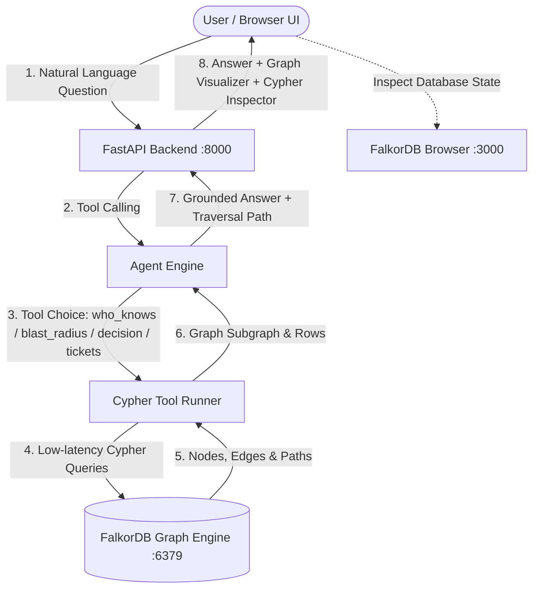

# Who Knows What — FalkorDB Company Brain Agent

> An AI agent that answers organizational questions by traversing a **FalkorDB** knowledge graph of people, teams, projects, systems, tickets, and decisions — and always visualizes the exact graph path it used.

**Hackathon:** [Graph Hacks: Context for AI Agents](https://www.wemakedevs.org/hackathons/falkordb) (WeMakeDevs × FalkorDB)  
**Track:** Track 03 — Company Brain (Solo)  
**Author:** [Lakshay Tayal](https://github.com/tayal01)  

---

## 🚀 The Core Idea

Large Language Models frequently hallucinate organizational structure, cross-service dependencies, and past architectural decisions when asked by engineers or managers.

**Who Knows What** solves this by strictly grounding an AI Agent in **FalkorDB**:
- **Zero Hallucination:** The agent possesses zero independent knowledge of employees or services. If it is not in the FalkorDB graph, it does not exist.
- **Mandatory Path Citing:** Every answer is accompanied by the exact graph relationship path (`Asha Patel —[:OWNS]→ Login ←[:DEPENDS_ON]— App API`).
- **FalkorDB as the Brain:** If FalkorDB is offline, the product has nothing to say.

---

## 🏛️ Architecture



---

## 📊 Graph Data Model (`northstar`)

The sample dataset represents **Northstar Labs**, a realistic tech company:

### Node Labels
| Node Label | Properties | Meaning |
|---|---|---|
| `Person` | `name`, `role`, `email`, `skills` | Employees & maintainers |
| `Team` | `name` | Platform, Payments, Mobile, Support |
| `Project` | `name`, `status` | Payments, Mobile App, Infra... |
| `System` | `name`, `criticality` | Login, Ledger, Notify, App API... |
| `Ticket` | `key`, `title`, `status`, `opened_on` | Active tasks & bug reports |
| `Decision` | `title`, `decided_on`, `summary` | Recorded architectural choices |
| `Document` | `title`, `kind`, `summary` | Runbooks, RFCs, and wikis |

### Relationships
- `(Person)-[:MEMBER_OF]->(Team)`
- `(Person)-[:WORKS_ON]->(Project)`
- `(Person)-[:OWNS]->(System)`
- `(Project)-[:USES]->(System)`
- `(System)-[:DEPENDS_ON]->(System)`
- `(Ticket)-[:ABOUT]->(Project|System)`
- `(Ticket)-[:ASSIGNED_TO]->(Person)`
- `(Decision)-[:MADE_BY]->(Person)`
- `(Decision)-[:ABOUT]->(Project|System)`
- `(Document)-[:DESCRIBES]->(Project|System)`

---

## ⚡ The 4 Demo Questions & Cypher Queries

### 1. "Who has worked on the payments system before?"
```cypher
MATCH (p:Person)-[r:OWNS|WORKS_ON]->(s:System)
WHERE toLower(s.name) CONTAINS toLower($name)
RETURN DISTINCT p.name AS person, p.role AS role, p.email AS email, type(r) AS relationship, 'Direct Owner/Maintainer' AS connection, s.name AS system

UNION

MATCH (p:Person)-[:WORKS_ON]->(pr:Project)-[:USES]->(s:System)
WHERE toLower(s.name) CONTAINS toLower($name)
RETURN DISTINCT p.name AS person, p.role AS role, p.email AS email, 'WORKS_ON_PROJECT' AS relationship, pr.name AS connection, s.name AS system

UNION

MATCH (p:Person)-[r:WORKS_ON]->(pr:Project)
WHERE toLower(pr.name) CONTAINS toLower($name)
RETURN DISTINCT p.name AS person, p.role AS role, p.email AS email, type(r) AS relationship, 'Project Contributor' AS connection, pr.name AS system
```

### 2. "If Login goes down, what else breaks, and who do I ping?"
```cypher
MATCH (down:System)
WHERE toLower(down.name) CONTAINS toLower($name)
OPTIONAL MATCH (other:System)-[:DEPENDS_ON]->(down)
OPTIONAL MATCH (proj:Project)-[:USES]->(down)
OPTIONAL MATCH (owner:Person)-[:OWNS]->(down)
RETURN down.name AS down_system,
       down.criticality AS criticality,
       collect(DISTINCT other.name) AS systems_that_break,
       collect(DISTINCT proj.name) AS projects_affected,
       collect(DISTINCT owner.name) AS owners_to_ping
```

### 3. "What did we decide about 2FA last month, and who decided it?"
```cypher
MATCH (d:Decision)-[:ABOUT]->(x)
WHERE toLower(d.title) CONTAINS toLower($topic)
   OR toLower(d.summary) CONTAINS toLower($topic)
   OR toLower(x.name) CONTAINS toLower($topic)
OPTIONAL MATCH (d)-[:MADE_BY]->(p:Person)
RETURN d.title AS title,
       d.decided_on AS decided_on,
       d.summary AS summary,
       p.name AS decided_by,
       p.role AS role,
       labels(x)[0] AS about_type,
       x.name AS about_target
```

### 4. "Which open tickets are about Payments, and who owns them?"
```cypher
MATCH (t:Ticket)-[:ABOUT]->(x)
WHERE toLower(t.status) = 'open'
  AND (toLower(x.name) CONTAINS toLower($name)
       OR toLower(t.title) CONTAINS toLower($name)
       OR toLower(t.key) CONTAINS toLower($name))
OPTIONAL MATCH (t)-[:ASSIGNED_TO]->(p:Person)
RETURN t.key AS key,
       t.title AS title,
       t.status AS status,
       t.opened_on AS opened_on,
       labels(x)[0] AS target_type,
       x.name AS target_name,
       p.name AS assignee,
       p.role AS assignee_role
ORDER BY t.opened_on DESC
```

---

## 🛠️ Quickstart (Run Locally)

### Prerequisites
- Docker & Docker Compose
- Python 3.10+

### 1. Start FalkorDB
```bash
docker compose up -d
```
FalkorDB will be available on port `6379`, and the FalkorDB Browser at `http://localhost:3000`.

### 2. Setup Python Environment & Seed Graph
```bash
python3 -m venv .venv
source .venv/bin/activate
pip install -r requirements.txt

# Seed Northstar graph into FalkorDB
python data/seed.py
```

### 3. (Optional) Configure LLM API Key
Copy `.env.example` to `.env`:
```bash
cp .env.example .env
```
Add your free [Groq API Key](https://console.groq.com) or OpenAI Key.  
*(Note: If no API key is provided, the application runs seamlessly in Direct FalkorDB Tool Mode!)*

### 4. Start Backend & UI
```bash
uvicorn backend.main:app --host 0.0.0.0 --port 8000
```
Open **`http://localhost:8000`** in your browser!

---

## 📁 Repository Structure

```
who-knows-what/
├── backend/
│   ├── main.py          # FastAPI web application & endpoints
│   ├── graph.py         # FalkorDB connection & Cypher tools
│   ├── agent.py         # LLM tool-calling & deterministic fallback
│   └── prompts.py       # System prompt & tool JSON schema
├── frontend/
│   ├── index.html       # Single-page web UI
│   ├── styles.css       # Dark mode glassmorphism styles
│   └── app.js           # Client interaction & live graph metrics
├── data/
│   ├── northstar.json   # Northstar Labs fake company dataset
│   └── seed.py          # Script to reset & seed FalkorDB graph
├── scripts/
│   └── demo_questions.md# Verified demo questions and expected paths
├── docker-compose.yml   # FalkorDB container configuration
├── DISCLOSURE.md        # AI tooling disclosure per hackathon rules
├── PLAN.md              # Original start-to-end hackathon master plan
└── README.md
```

---

## ⚖️ License & Disclosure
Built for Graph Hacks: Context for AI Agents. Fake data only. Disclosures documented in [DISCLOSURE.md](./DISCLOSURE.md).
